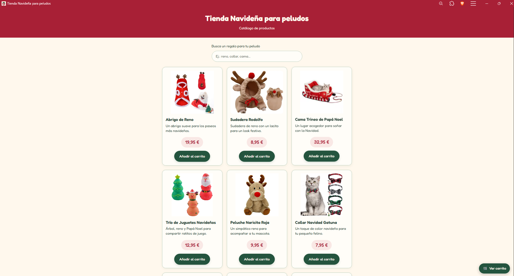
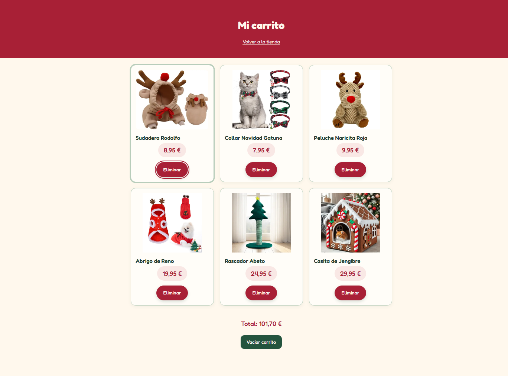

#  Tienda navideña para peludos

Una tienda navideña para mascotas en formato **PWA instalable**. Explora el catálogo, busca regalos y añade tus favoritos al carrito.

##  Qué puedes hacer

- Buscar productos del catálogo por nombre.
- Añadir productos al carrito y consultar tu selección.
- Instalar la aplicación desde un navegador compatible.

##  Vista del carrito

##  Tecnologías

- **Frontend** · HTML, CSS, TypeScript y Vite con `vite-plugin-pwa`.
- **Backend** · Node.js, Express y TypeScript.
- **Base de datos** · MySQL mediante XAMPP en el entorno local. El catálogo se carga desde `GET /api/productos`.
